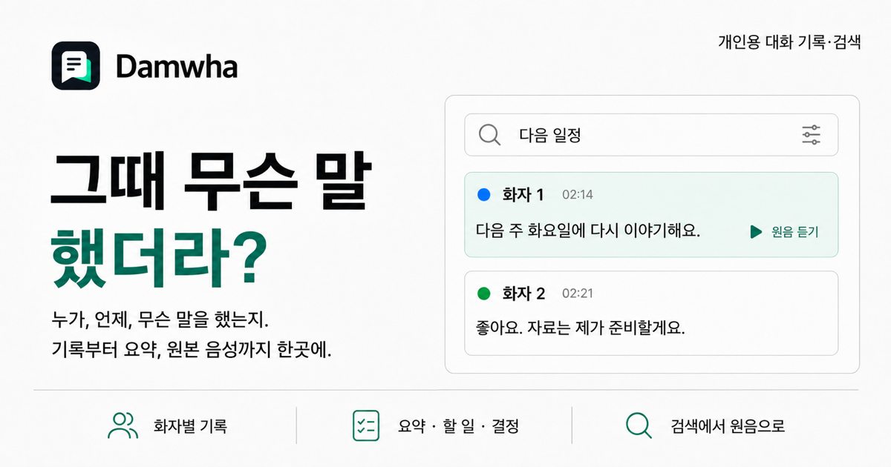
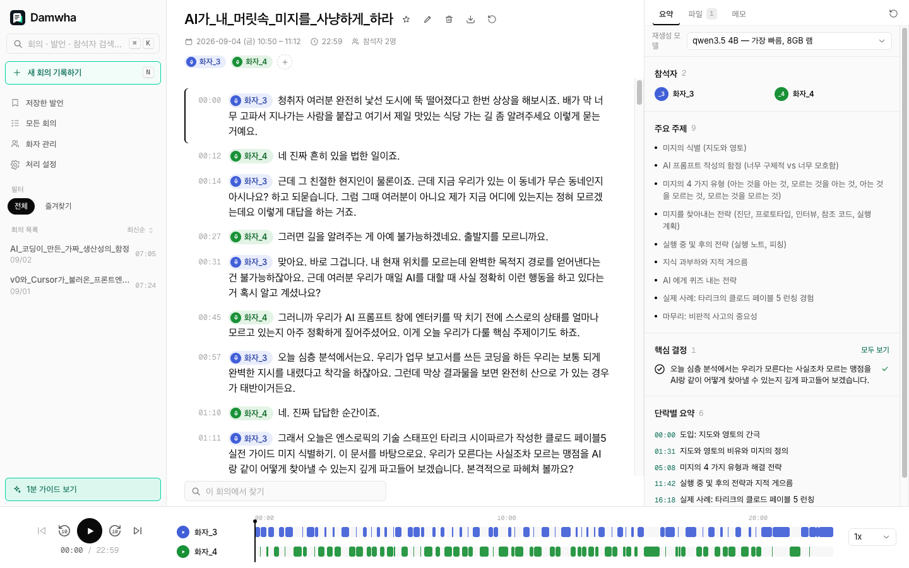
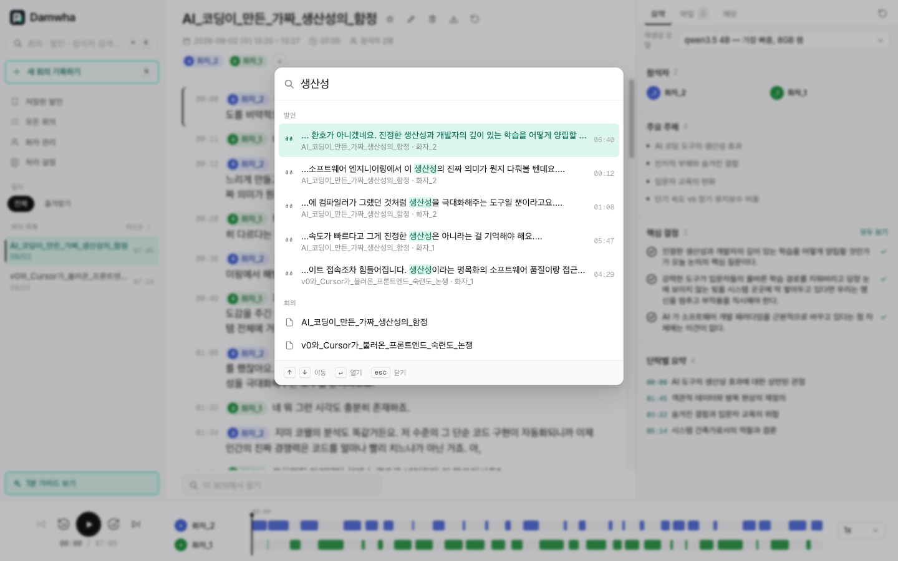
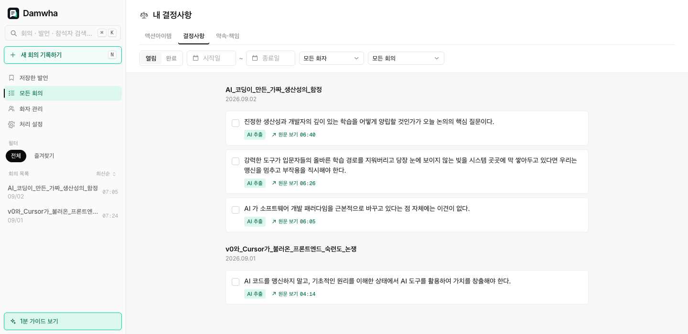
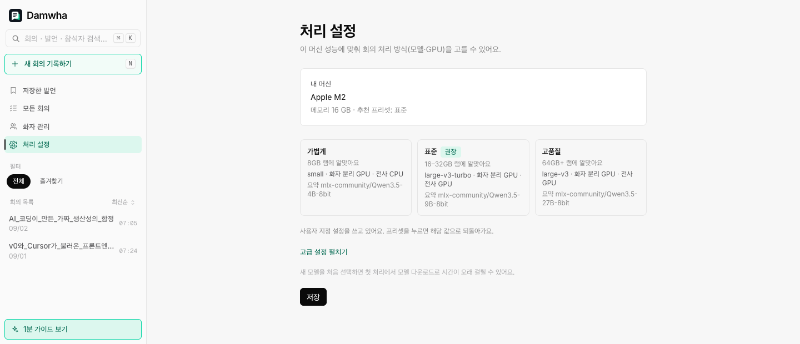
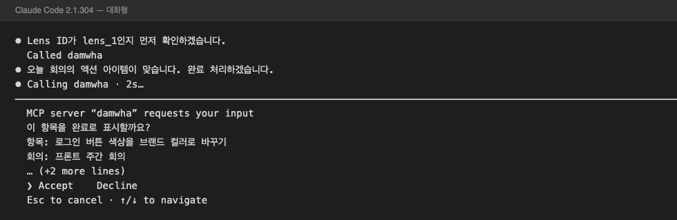
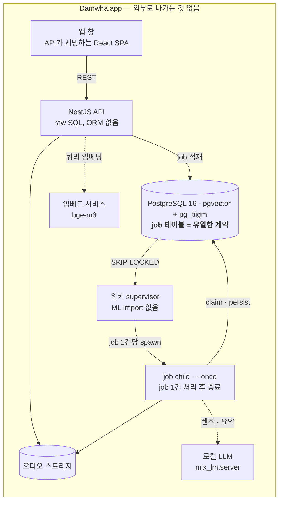

<div align="center">

<!-- TODO: 15–20초 GIF로 교체 — ⌘K 검색 → 결과 클릭 → 그 순간부터 재생 -->


# 담화 (Damwha)

**대화를 녹음하고, 어떤 문장이든 찾고, 그 말이 나온 순간을 다시 듣는다.**<br>
화자가 붙고 검색되는 대화 기억 — 전부 내 맥에서 돈다.

[](https://github.com/Yjason-K/Damwha/releases/latest)
[](#설치)
[](https://github.com/Yjason-K/Damwha/releases)
[](LICENSE)

### [⬇ macOS용 다운로드](https://github.com/Yjason-K/Damwha/releases/latest) · [▶ 공개 데모](https://damwha-demo.0kimjae.dev) · [제품 사이트](https://damwha.0kimjae.dev/ko/)

[English](README.md) · **한국어**

</div>

> **녹음하기 전에** — 담화는 녹음 고지를 띄우지 않고 대화에 참여한 *모든 사람*의
> 성문(voiceprint)을 저장한다. 본인 것만이 아니다. 동의를 받을 책임은 이걸 돌리는
> 사람에게 있다. → [녹음과 동의](#녹음과-동의)

## 왜 담화인가

대화는 계속 쌓이는데 "그때 그 얘기"를 다시 찾기는 어렵다. 녹취록은 길고 기존 STT
서비스는 매번 "참석자 1"을 손으로 고쳐야 했다.

담화의 1급 객체는 **발언(utterance)**이다. 발언 하나가 *누가* 말했는지, *언제*(어느
대화, 몇 초) 말했는지, 원문과 원본 오디오, 앞뒤 맥락에 묶인다.

- **발언 점프** — 검색 결과에서든 추출된 결정에서든, 정확히 그 순간으로 뛰어 직접 듣는다.
- **화자 자동 식별** — 등록한 사람의 성문과 대조해 대화를 가로질러 같은 사람을 알아본다.
- **처음부터 로컬** — 전사·화자 분리·검색·요약 LLM이 전부 내 맥에서 돈다. 계정도,
  클라우드 ML도 없다.

회의든 인터뷰든 통화든 그냥 대화든 상관없다. 할 일·결정은 대화에 있을 때만 나오고,
없으면 그 섹션이 알아서 사라진다.

**비목표** — 팀 위키, 구성원별 분석, 회의 지식 그래프. 개인 대화 기억이지 팀 모니터링
도구가 아니다.

## 설치

1. [Releases](https://github.com/Yjason-K/Damwha/releases/latest)에서 최신 **DMG**를
   받는다(서명·공증 완료).
2. 열어서 **Damwha**를 Applications로 끌어다 놓는다.
3. 실행한다. DB·API·ML 워커·ffmpeg가 앱 안에 들어 있어 Docker도 Postgres도 따로 설정할
   필요가 없다.

**요구 사항:** macOS 15.0 이상, Apple Silicon. 모델은 처음 쓸 때 받는다. 디스크는 가장
작은 구성이 약 8 GB, 가장 큰 구성이 약 35 GB다. 용량·저장 위치·미리 받기·지우기는
[`docs/MODELS.md`](docs/MODELS.md).

설치 전에 보고 싶다면 **[공개 데모](https://damwha-demo.0kimjae.dev)** — 읽기 전용,
가입 없음, 1분 둘러보기가 붙어 있다. 샘플 대화 3건은 Google NotebookLM Audio
Overview(**AI 생성 음성, 실제 인물 아님**)를 M2에서 실제 파이프라인으로 처리한 결과다.

> 앱 UI는 **한국어와 영어**를 지원하고 요약도 둘 중 하나로 쓸 수 있다.

## 기능

| | |
| --- | --- |
|  |  |
| **화자가 붙은 전사.** 대화 목록·전사·인사이트 3-pane. 아래 레일은 녹음 전체의 화자별 타임라인이라, 아무 데나 클릭하거나 드래그하면 그 지점으로 이동한다. | **⌘K 검색은 어느 화면에나.** bge-m3 벡터 + BM25/pg_bigm 하이브리드로 발언과 대화를 함께 찾는다. 결과를 누르면 곧장 그 순간으로 뛴다. |
|  |  |
| **모든 대화를 가로지르는 렌즈.** 로컬 LLM이 뽑은 할 일·결정·약속을 근거 발언 링크와 함께 본다. 고칠 수 있고 재추출해도 사람이 손댄 항목은 남는다. | **머신에 맞춘 프리셋.** 맥의 실제 사양을 읽어 프리셋을 추천한다. 프리셋마다 Whisper 크기·요약 모델·단계별 CPU/GPU 배치가 정해져 있다. |

이 밖에:

- 실시간 녹음(미리보기 포함)
- 대화별 메모와 태그
- 화자 등록
- 내보내기
- 예전 녹음을 새 모델로 재처리
- **암호화 공유 링크** — 서버에는 암호문만 남고, 키는 링크의 `#` 뒤에만 있다

### 코딩 에이전트용 CLI · MCP

앱에 `damwha` 명령과 stdio **MCP 서버**가 함께 실린다. Claude Code·Codex 같은 MCP
클라이언트가 대화를 검색하고, 전사를 읽고, 오디오를 올리고, 할 일을 챙길 수 있다.
**설정 › CLI · MCP**에서 설치하거나 직접:

```bash
mkdir -p ~/.local/bin && ln -s /Applications/Damwha.app/Contents/Resources/cli/damwha ~/.local/bin/damwha
claude mcp add --transport stdio --scope user damwha -- ~/.local/bin/damwha mcp

damwha search "출시일" --limit 5
damwha upload interview.m4a --wait
```



할 일 완료처럼 무언가를 바꾸는 동작은 클라이언트에 먼저 확인 창을 띄운다. 전체 문서:
[CLI 문서](https://damwha.0kimjae.dev/ko/cli/) · [`cli/README.md`](cli/README.md).

## 프라이버시 — 무엇이 어디서 도나

| 맥 안에 남는 것 | 맥 밖으로 나가는 것 |
| --- | --- |
| 오디오·전사·성문·요약·검색 인덱스(번들 PostgreSQL) | **모델 다운로드** — Hugging Face에서, 처음 쓸 때만 |
| 전사(mlx-whisper)·화자 분리(pyannote)·화자 식별(ECAPA)·임베딩(bge-m3) | **공유 링크** — 만들 때만. 암호화된 덩어리만 올라가고 키는 올라가지 않는다 |
| 요약·렌즈 LLM(`mlx_lm.server`, 앱이 관리) | **업데이트 확인** — 하루 한 번 GitHub Releases API에 새 버전이 있는지 묻는다 |

텔레메트리·분석·계정은 없다.

## 어떻게 돌아가나



```
오디오 → ffmpeg → VAD → 화자 분리 → 화자 식별(pgvector 코사인) → STT(Whisper)
      → 구조화 JSON → 검색 인덱싱 → 렌즈 ∥ 요약 → 저장
```

**API와 ML 워커는 HTTP로 대화하지 않는다.** 둘 사이의 계약은 Postgres `job` 테이블
하나뿐이고 TypeScript 쪽 zod와 Python 쪽 pydantic이 같은 payload를 각각 검증한다.
워커 supervisor는 ML 라이브러리를 import하지 않고 job마다 새 child를 띄운다. 그래서
MLX/torch가 잡은 GPU 메모리를 OS가 매번 회수하고 메모리가 쌓여 OOM으로 가지 않는다.

검색·경로 추적이 되는 대화형 다이어그램은 [`docs/diagrams/`](docs/diagrams/README.md)에 있다.

## 녹음과 동의

담화는 **녹음 고지를 띄우지 않고**, **참여자 모두의 성문**을 저장하며 내보내기에 확인
절차가 없다. 개인용·로컬 전용이라는 설계만으로 법적 의무가 면제되지는 않는다. 녹음과
처리의 적법성은 관할·대화의 성격·목적에 따라 갈린다. **이 도구로 한 녹음과 그 처리에
대한 법적 책임은 전적으로 쓰는 사람에게 있다.** 법률 자문이 아니다. 애매하면 녹음
전에 동의를 받을 것.

## 개발

pnpm 모노레포 + uv가 관리하는 Python 프로젝트 하나다.

| 경로 | 무엇인가 |
| --- | --- |
| `be/` | NestJS 10 API — Postgres(pgvector + pg_bigm) 위 raw SQL |
| `be/worker/` | Python 3.12 ML 워커(uv, pnpm 워크스페이스 멤버 아님) |
| `fe/` | React 19 + Vite 8 + Tailwind 4 SPA |
| `desktop/` | Electron 셸 — 번들 Postgres·API·워커·임베드를 감독 |
| `cli/` | `damwha` 명령과 stdio MCP 서버 — 앱과 HTTP로만 통신 |
| `share/` | 공유 링크 서버 — 암호문 API + 정적 뷰어 |
| `site/` | Astro 제품 사이트([damwha.0kimjae.dev](https://damwha.0kimjae.dev/ko/)) |
| `packages/` | `contracts`(be·fe가 공유하는 wire enum)·`share-format`·`share-view` |

**준비물:** Node 22(`.nvmrc`), `corepack enable`로 pnpm 10.26, Docker,
[uv](https://docs.astral.sh/uv/), `PATH`의 `ffmpeg`. Apple Silicon이 상정한 타깃이다.

```bash
corepack enable && pnpm install
cp be/.env.example be/.env
cp be/worker/.env.example be/worker/.env
cp fe/.env.example fe/.env
pnpm db:up && pnpm be:migrate   # Postgres가 먼저 — 나머지는 DB하고만 말한다
pnpm dev                        # API :3000 (Swagger /docs) + Vite :5173
pnpm worker:sync && pnpm worker # ML 워커. 없으면 업로드가 queued에 머문다
pnpm desktop:dev                # 또는 전체를 Electron 앱으로
```

자주 밟는 규칙 셋:

1. 모든 명령은 루트에서 위 스크립트로 돌린다. `be/` 안에서 `npm install`은 하지 않는다.
2. `.env`는 패키지마다 따로 둔다. 루트 `.env`는 없다.
3. `STORAGE_ROOT`는 `be/.env`에서 `./storage`, `be/worker/.env`에서 `../storage`로
   일부러 다르다. 둘이 같은 디렉터리로 풀려야 한다.

<details>
<summary><b>신경 써야 하는 환경 변수</b></summary>

각 프로세스는 자기 옆의 `.env`를 읽는다(API는 `be/.env`, 워커와 임베드는
`be/worker/.env`, Vite는 `fe/.env`이고 `VITE_` 키만 브라우저에 간다). `.env.example`은
빠짐없이 채워져 있고 주석도 달려 있다. 복사해서 고치고, 직접 쓰지 않는다.

- **`HF_TOKEN`**(워커) — 앱 밖에서만 필요하다(`DIARIZATION_MODEL_DIR` 없이
  `pnpm worker`). 데스크톱 앱은 화자 분리 모델을 번들로 싣는다.
- **`LENS_LLM_BASE_URL`**(워커) — 필수이고 기본값이 없으며 포트까지 명시해야 한다.
- **`SUMMARY_LLM_MODEL` / `LENS_LLM_MODEL`** — `be/.env`와 `be/worker/.env`에서
  같아야 한다. `SUMMARY_LLM_MODEL`이 `packages/contracts/src/index.ts`의 카탈로그에
  없으면 API가 부팅하지 않는다.
- **`SEARCH_EMBEDDING_MODEL` / `SEARCH_EMBEDDING_DIM`** — 두 파일에서 같아야 한다.
  어긋나면 검색이 조용히 키워드 전용으로 떨어진다.
- **`IDENTIFY_THRESHOLD` / `IDENTIFY_SUGGEST_THRESHOLD`** —
  `be/worker/scripts/eval_speaker_id.py`로 측정한 값이다. 바꾸려면 그 스크립트로 다시
  잰다. 눈대중으로 고치지 않는다.
- API는 `.env`를 부팅 때 한 번만 읽는다. `--watch`는 `.env` 변경을 잡지 않으므로,
  고쳤으면 재시작한다.

</details>

<details>
<summary><b>ML 워커 · 모델 · 임베드 서비스 · LLM</b></summary>

```bash
pnpm worker:sync       # 실제 모델: mlx-whisper·pyannote·ECAPA·bge-m3 (수십 GB)
pnpm worker:sync:test  # 결정적 의존성만. torch를 지운다 — 다음엔 worker:sync를 다시
pnpm worker:test       # pytest (Docker / testcontainers)
pnpm embed             # 127.0.0.1:8100의 bge-m3. API의 검색 쿼리만 쓴다
```

- **화자 분리 모델:** `pyannote/speaker-diarization-community-1`은 앱에 들어 있다. 앱
  밖에서는 Hugging Face에서 조건에 동의하고 `HF_TOKEN`을 넣거나,
  `desktop/scripts/build-models.sh`가 스테이징한 폴더를 `DIARIZATION_MODEL_DIR`로
  가리킨다.
- **임베드 서비스가 죽어 있으면** 아무것도 터지지 않고 검색이 BM25/pg_bigm으로 조용히
  떨어진다. 검색 품질을 판단하기 전에 `curl -s 127.0.0.1:8100/health`로 확인한다.
- **렌즈/요약 LLM:** 기본값 `LENS_LLM_MANAGED=true`면 job 직전에 `mlx_lm.server`를
  띄우고 끝나면 내린다. 직접 띄운 서버가 있으면 감지해서 재사용한다.
- **Apple이 아닌 하드웨어:** STT가 CPU의 `faster-whisper`로 떨어진다. `gpu`를 요구하는
  job은 일부러 `gpu_unavailable`로 영구 실패한다. `light` 프리셋이나 CPU 장치를 쓰고
  다른 OpenAI 호환 LLM 서버를 붙인다.

스모크 스크립트와 품질 측정 도구는 [`be/worker/SMOKE.md`](be/worker/SMOKE.md)에 있다.

</details>

<details>
<summary><b>자주 쓰는 명령</b></summary>

```bash
pnpm build                  # 전체 패키지
pnpm test                   # be(jest, Docker 필요) + fe(vitest)
pnpm lint                   # fe
pnpm be <script>            # damwha-be의 아무 스크립트, 예: `pnpm be test:e2e`
pnpm fe <script>            # damwha-fe의 아무 스크립트
pnpm cli build|test|lint    # damwha CLI / MCP 서버
pnpm share:dev              # 공유 서버 + 뷰어 :8787
pnpm site:dev               # 제품 사이트 :4321
```

</details>

**다음에 읽을 문서:**

- [`be/CLAUDE.md`](be/CLAUDE.md) — job 계약, 소유권 가드, 화자 식별 임계값
- [`fe/CLAUDE.md`](fe/CLAUDE.md)·[`fe/DESIGN.md`](fe/DESIGN.md) — UI
- [`desktop/CLAUDE.md`](desktop/CLAUDE.md) — 번들·서명·릴리스
- [`deploy/demo/README.md`](deploy/demo/README.md) — 공개 데모. 설치본과 별개인 읽기 전용
  웹 배포다

## 라이선스

[MIT](LICENSE) © 2026 김영재. 라이선스가 덮는 것은 이 저장소의 소스뿐이다.

## 감사의 말

- [`pyannote/speaker-diarization-community-1`](https://huggingface.co/pyannote/speaker-diarization-community-1)
  © [pyannoteAI](https://www.pyannote.ai) and pyannote contributors,
  [CC BY 4.0](https://creativecommons.org/licenses/by/4.0/). 앱 안에 변경 없이 실어
  재배포하고, 인용(Plaquet & Bredin, INTERSPEECH 2023 외 모델 카드에 적힌 것)은 모델
  옆의 `NOTICE.txt`에 있다.
- Whisper·Qwen 요약 모델·`bge-m3`·ECAPA 화자 임베더는 재배포하지 **않는다**. 각자
  저장소에서 각자의 약관으로 받는다.
- [MLX](https://github.com/ml-explore/mlx)·[pgvector](https://github.com/pgvector/pgvector)·[pg_bigm](https://github.com/pgbigm/pg_bigm)·[FFmpeg](https://ffmpeg.org) 위에 만들었다.
