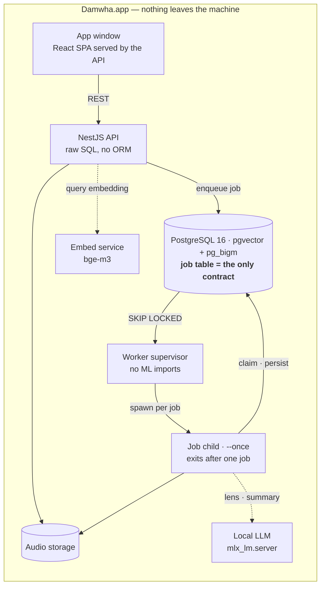

<div align="center">

<!-- TODO: replace with a 15–20 s GIF: ⌘K search → click a hit → playback jumps to that moment -->


# Damwha (담화)

**Record your conversations. Find any sentence. Hear the exact moment it was said.**<br>
Speaker-attributed, searchable conversation memory that runs entirely on your Mac.

[](https://github.com/Yjason-K/Damwha/releases/latest)
[](#install)
[](https://github.com/Yjason-K/Damwha/releases)
[](LICENSE)

### [⬇ Download for macOS](https://github.com/Yjason-K/Damwha/releases/latest) · [▶ Live demo](https://damwha-demo.0kimjae.dev) · [Website](https://damwha.0kimjae.dev)

**English** · [한국어](README.ko.md)

</div>

> **Before you record:** Damwha shows no recording notice, and it stores a voiceprint
> for *every* participant, not just you. Getting consent is up to the person running
> it. → [Recording and consent](#recording-and-consent)

## Why Damwha

Conversations pile up, and finding "that thing we said" never gets easier. Transcripts
are long, and every STT service makes you rename "Speaker 1" by hand, every single time.

Damwha treats the **utterance** as the primary object. Each one is tied to *who* said
it, *when* (which conversation, which second), the original text and audio, and the
turns around it.

- **Utterance jump.** From a search hit or an extracted decision, land on the exact
  moment and hear it.
- **Speakers named automatically.** Voiceprints are matched against people you have
  enrolled, across every conversation.
- **Local by design.** Transcription, diarization, search and the summary LLM all run
  on your Mac. No account, no cloud ML.

It works for any recording: a meeting, an interview, a call, or just a chat. Action
items and decisions show up when the conversation has them; when it doesn't, that
section stays empty and hidden.

**Not a goal:** team wikis, per-member analytics, or meeting knowledge graphs. Damwha
is a personal conversation memory, not a team monitoring tool.

## Install

1. Download the latest **DMG** from [Releases](https://github.com/Yjason-K/Damwha/releases/latest)
   (signed and notarized).
2. Open it and drag **Damwha** into Applications.
3. Launch it. The database, API, ML worker and ffmpeg ship inside the app, so there is
   no Docker or Postgres to set up.

**Requirements:** macOS 15.0+ on Apple Silicon. Models download on first use. The smallest
setup needs about 8 GB of disk, and the largest about 35 GB. Sizes, locations, and
how to pre-download or delete them: [`docs/MODELS.md`](docs/MODELS.md).

Want to look before installing? The **[live demo](https://damwha-demo.0kimjae.dev)**
is read-only, needs no signup, and opens with a one-minute guided tour. Its three
sample conversations are Google NotebookLM Audio Overviews (AI-generated voices, not
real people), processed by the real pipeline on an M2.

> The app UI is available in **Korean and English**, and summaries can be written in
> either. The design docs are in Korean. Code, API and this README are in English.

## Features

| | |
| --- | --- |
|  |  |
| **Speaker-attributed transcript.** Conversation list, transcript, and insight panel side by side. The bottom rail is a per-speaker timeline of the whole recording: click or drag anywhere to seek. | **⌘K search, everywhere.** Hybrid search (bge-m3 vectors + BM25/pg_bigm) over utterances *and* conversations. Every hit jumps straight to its moment. |
|  |  |
| **Lenses across every conversation.** Action items, decisions and promises extracted by a local LLM, each linked to its evidence. Editable, and re-extraction keeps anything you touched. | **Hardware-aware presets.** Damwha reads your Mac's actual spec and recommends a preset that fixes the Whisper size, the summary model and per-stage CPU/GPU placement. |

Also included:

- live recording with a running preview
- per-conversation notes and tags
- speaker enrollment
- export
- re-processing old recordings with newer models
- **encrypted share links**: the server stores only ciphertext, and the key lives in
  the link's `#` fragment

### CLI and MCP for coding agents

The app ships a `damwha` command and a stdio **MCP server**, so Claude Code, Codex or any
MCP client can search your conversations, read transcripts, upload audio and track action
items. Install it from **Settings › CLI · MCP**, or by hand:

```bash
mkdir -p ~/.local/bin && ln -s /Applications/Damwha.app/Contents/Resources/cli/damwha ~/.local/bin/damwha
claude mcp add --transport stdio --scope user damwha -- ~/.local/bin/damwha mcp

damwha search "launch date" --limit 5
damwha upload interview.m4a --wait
```


Write actions such as completing an action item open a confirmation prompt in the
client first. Full reference: [CLI docs](https://damwha.0kimjae.dev/cli/) ·
[`cli/README.md`](cli/README.md).

## Privacy: what runs where

| Stays on your Mac | Leaves your Mac |
| --- | --- |
| Audio, transcripts, voiceprints, summaries, search index (bundled PostgreSQL) | **Model downloads** from Hugging Face, on first use only |
| Transcription (mlx-whisper), diarization (pyannote), speaker ID (ECAPA), embeddings (bge-m3) | **Share links**, only when you create one: an encrypted blob is uploaded, and the key never is |
| Summary and lens LLM (`mlx_lm.server`, managed by the app) | **Update check**: once a day, the app asks the GitHub Releases API whether a newer version exists |

No telemetry, no analytics, no account.

## How it works



```
audio → ffmpeg → VAD → diarization → speaker ID (pgvector cosine) → STT (Whisper)
      → structured JSON → search indexing → lens ∥ summary → store
```

**The API and the ML worker never talk over HTTP.** The Postgres `job` table is the only
contract between them, validated by zod on the TypeScript side and pydantic on the Python
side. The worker's supervisor imports no ML libraries and spawns a fresh child per job,
so the OS reclaims MLX/torch GPU memory between jobs instead of building up to an OOM.

Interactive, path-traceable versions of these diagrams live in
[`docs/diagrams/`](docs/diagrams/README.md).

## Recording and consent

Damwha **shows no recording notice**, stores a **voiceprint for every participant**, and
exports without a confirmation step. A personal, local-only design does not exempt you
from the law: whether a recording and its processing are lawful depends on your
jurisdiction, the conversation, and the purpose. **Legal responsibility for anything
recorded with this tool rests entirely with the person using it.** This is not legal
advice. When in doubt, ask before you record.

## Development

Damwha is a pnpm monorepo plus one uv-managed Python project.

| Path | What it is |
| --- | --- |
| `be/` | NestJS 10 API over Postgres (pgvector + pg_bigm), raw SQL |
| `be/worker/` | Python 3.12 ML worker (uv, not a pnpm workspace member) |
| `fe/` | React 19 + Vite 8 + Tailwind 4 SPA |
| `desktop/` | Electron shell that supervises the bundled Postgres, API, worker and embed service |
| `cli/` | `damwha` command and stdio MCP server, which talks to the app over HTTP only |
| `share/` | Share-link server: ciphertext API plus a static viewer |
| `site/` | Astro product site ([damwha.0kimjae.dev](https://damwha.0kimjae.dev)) |
| `packages/` | `contracts` (wire enums shared by be and fe), `share-format`, `share-view` |

**Prerequisites:** Node 22 (`.nvmrc`), pnpm 10.26 via `corepack enable`, Docker,
[uv](https://docs.astral.sh/uv/), and `ffmpeg` on `PATH`. Apple Silicon is the intended
target.

```bash
corepack enable && pnpm install
cp be/.env.example be/.env
cp be/worker/.env.example be/worker/.env
cp fe/.env.example fe/.env
pnpm db:up && pnpm be:migrate   # Postgres first: everything else only talks to it
pnpm dev                        # API :3000 (Swagger /docs) + Vite :5173
pnpm worker:sync && pnpm worker # ML worker; without it, uploads stay "queued"
pnpm desktop:dev                # or run the whole thing as the Electron app
```

Three rules that bite:

1. Run everything from the repo root through these scripts. Never run `npm install`
   inside `be/`.
2. `.env` files are per-package. There is no root `.env`.
3. `STORAGE_ROOT` is `./storage` in `be/.env` and `../storage` in `be/worker/.env` on
   purpose: both must resolve to the same directory.

<details>
<summary><b>Environment variables that need attention</b></summary>

Each process loads the `.env` next to it (`be/.env` for the API, `be/worker/.env` for the
worker and embed service, `fe/.env` for Vite, where only `VITE_` keys reach the browser).
The `.env.example` files are complete and commented: copy and edit them, don't hand-write
your own.

- **`HF_TOKEN`** (worker): only needed outside the app (`pnpm worker` without
  `DIARIZATION_MODEL_DIR`). The desktop app bundles the diarization model.
- **`LENS_LLM_BASE_URL`** (worker): required, no default, and the port must be explicit.
- **`SUMMARY_LLM_MODEL` / `LENS_LLM_MODEL`**: must be identical in `be/.env` and
  `be/worker/.env`. `SUMMARY_LLM_MODEL` must be in the catalog in
  `packages/contracts/src/index.ts`, or the API refuses to boot.
- **`SEARCH_EMBEDDING_MODEL` / `SEARCH_EMBEDDING_DIM`**: identical in both files, or search
  quietly degrades to keyword-only.
- **`IDENTIFY_THRESHOLD` / `IDENTIFY_SUGGEST_THRESHOLD`**: measured with
  `be/worker/scripts/eval_speaker_id.py`. Re-measure with that script; don't eyeball them.
- The API reads `.env` once at boot. Restart it after editing, because `--watch` does not
  pick up `.env` changes.

</details>

<details>
<summary><b>ML worker, models, embed service and LLM</b></summary>

```bash
pnpm worker:sync       # real models: mlx-whisper, pyannote, ECAPA, bge-m3 (tens of GB)
pnpm worker:sync:test  # deterministic deps only. This UNINSTALLS torch: re-run worker:sync after
pnpm worker:test       # pytest (Docker / testcontainers)
pnpm embed             # bge-m3 on 127.0.0.1:8100, used only by the API for search queries
```

- **Diarization model:** `pyannote/speaker-diarization-community-1` is bundled in the app.
  Outside it, either accept the terms on Hugging Face and set `HF_TOKEN`, or point
  `DIARIZATION_MODEL_DIR` at the folder staged by `desktop/scripts/build-models.sh`.
- **Embed service down?** Nothing crashes. Search silently falls back to BM25/pg_bigm, so
  check `curl -s 127.0.0.1:8100/health` before judging search quality.
- **Lens/summary LLM:** with the default `LENS_LLM_MANAGED=true`, the job starts
  `mlx_lm.server` just before it runs and stops it afterwards. A server you started
  yourself is detected and reused.
- **Non-Apple hardware:** STT falls back to `faster-whisper` on the CPU. A job that asks
  for `gpu` fails permanently (`gpu_unavailable`), on purpose. Use the `light` preset or
  CPU devices, plus another OpenAI-compatible LLM server.

End-to-end smoke scripts and quality-measurement tooling: [`be/worker/SMOKE.md`](be/worker/SMOKE.md).

</details>

<details>
<summary><b>Common tasks</b></summary>

```bash
pnpm build                  # all packages
pnpm test                   # be (jest, needs Docker) + fe (vitest)
pnpm lint                   # fe
pnpm be <script>            # any damwha-be script, e.g. `pnpm be test:e2e`
pnpm fe <script>            # any damwha-fe script
pnpm cli build|test|lint    # damwha CLI / MCP server
pnpm share:dev              # share server + viewer on :8787
pnpm site:dev               # product site on :4321
```

</details>

**Where to read next:**

- [`be/CLAUDE.md`](be/CLAUDE.md) covers the job contract, ownership guards and speaker-ID
  thresholds.
- [`fe/CLAUDE.md`](fe/CLAUDE.md) and [`fe/DESIGN.md`](fe/DESIGN.md) cover the UI.
- [`desktop/CLAUDE.md`](desktop/CLAUDE.md) covers bundling, signing and release.
- [`deploy/demo/README.md`](deploy/demo/README.md) covers the public demo, which is a
  separate read-only web deployment.

## License

[MIT](LICENSE) © 2026 Youngjae Kim. The license covers this repository's source only.

## Acknowledgments

- [`pyannote/speaker-diarization-community-1`](https://huggingface.co/pyannote/speaker-diarization-community-1)
  © [pyannoteAI](https://www.pyannote.ai) and pyannote contributors,
  [CC BY 4.0](https://creativecommons.org/licenses/by/4.0/). It is redistributed
  unmodified inside the app, and its citations (Plaquet & Bredin, INTERSPEECH 2023, and
  others on the model card) are in the `NOTICE.txt` shipped next to it.
- Whisper, the Qwen summary models, `bge-m3` and the ECAPA speaker embedder are **not**
  redistributed. Each one downloads from its own repository under its own terms.
- Built on [MLX](https://github.com/ml-explore/mlx), [pgvector](https://github.com/pgvector/pgvector),
  [pg_bigm](https://github.com/pgbigm/pg_bigm) and [FFmpeg](https://ffmpeg.org).
